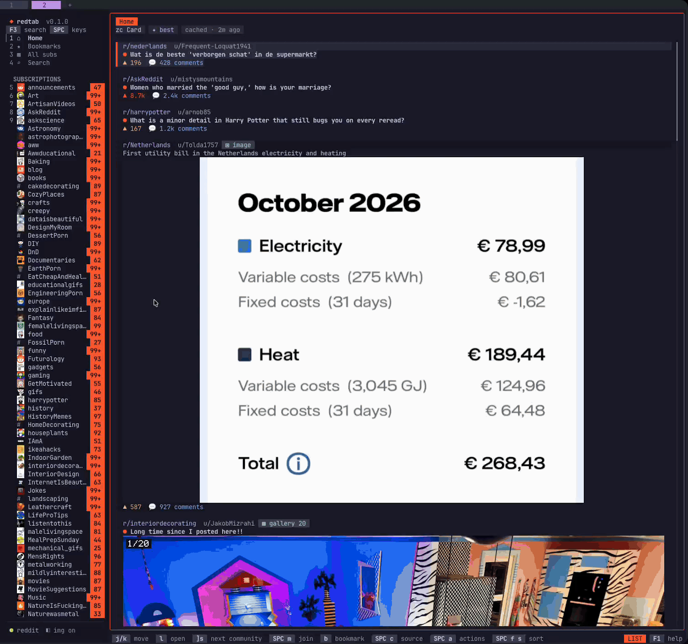

# RedTab

[](https://crates.io/crates/redtab)
[](https://github.com/kapral18/redtab/actions/workflows/release.yml)
[](LICENSE)

Reddit in your terminal, with tabs, inline media and keyboard controls.



- Browse Home, subscriptions and subreddit tabs.
- View images and galleries, play videos and GIFs, and read discussions side by side.
- Search Reddit, follow comment threads, vote, save, reply and post.
- Switch accounts, bookmark posts and keep unread counts across restarts.

No Reddit API registration is needed.

## Before you sign in

- redtab uses your Reddit web session and Reddit's website endpoints, not the
  official API, and identifies itself as Chrome. Reddit can restrict or suspend
  accounts it flags as automated, and can change these endpoints at any time.
- The saved session has your account's full web access. It is stored in the macOS
  Keychain or Linux Secret Service, never in a plain file.
- The default sign-in opens a separate login window and never reads your browser's
  cookies. Importing from a Chromium profile on macOS instead asks you to let redtab
  use "<Browser> Safe Storage", which decrypts that browser's cookies and saved
  passwords; redtab decrypts only reddit.com cookies, in its own process
  ([details](docs/accounts.md#os-prompts)).

## Get started

Install with Homebrew on macOS or Linux:

```sh
brew install kapral18/tap/redtab
redtab
```

Or download a build from [Releases](https://github.com/kapral18/redtab/releases)
and [verify it](docs/guide.md#prebuilt-binaries), or build from source with
Rust 1.90+, CMake, a C/C++ compiler and libclang: `cargo install redtab --locked`.

On first launch, **Connect Reddit** preselects **Sign in in a new login window**
(needs Chrome, Chromium, Brave or Edge). Press `Enter`, sign in there and confirm
your account.
Press `Space` for action groups and `?` for help. Install `ffmpeg` for inline video.

## Documentation

[User guide](docs/guide.md) · [Accounts](docs/accounts.md) ·
[Settings](docs/configuration.md) · [Keyboard shortcuts](docs/keybindings.md) ·
[Privacy](docs/accounts.md#data-and-privacy) · [Development](docs/development.md)

## License

[MIT](LICENSE)
